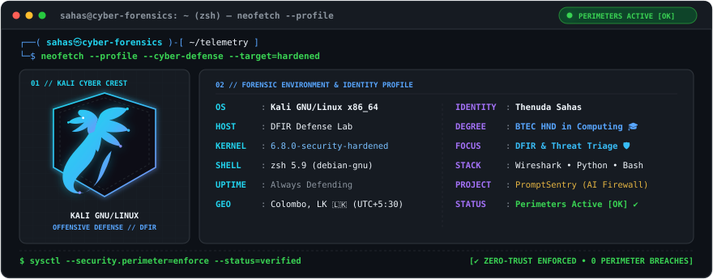

<!-- ========================================================================= -->
<!-- THENUDA SAHAS SOORIYAARACHCHI | CYBERSECURITY & DIGITAL FORENSICS PORTFOLIO -->
<!-- ========================================================================= -->

  <!-- Dynamic Cybersecurity Waving Banner -->
  

  <!-- Dynamic Typing Title -->
  

   

  <!-- Quick Navigation Pills -->
  
  
  
  
  
  

    

  <!-- Direct Communication & Social Links -->
  
  
  
  

    

  <!-- Live Status & Verification -->
  
  

---

### 🖥️ Forensic & Security Terminal (`whoami`)

  

---

## 🎯 Practical Security Labs & Research Platforms

  
  &nbsp;
  
  &nbsp;
  
  &nbsp;
  

---

## 🧰 Technical Arsenal & Tooling Matrix

  <!-- Symmetrical 2x9 Tech Stack Grid -->
  
   
  

    

  <!-- Specific Technology Badges -->
  
  
  
  
  
  
  
  

    

  <!-- Specialization Capability Badges -->
  
  &nbsp;
  
  &nbsp;
  

---

## 🚀 Featured Projects

  
  

  
  

  
  &nbsp;
  

---

## 📈 Activity & Development Velocity

<!-- Among Us Impostor Incinerating Contributions Animation -->

  

<!-- Real-Time Auto-Updating GitHub Analytics & Streak Suite -->

  
  

  

---

## 📡 Encrypted Uplink & Direct Communications

  

<!-- 100% Clickable One-Click Dispatch Badges -->

  
  &nbsp;&nbsp;
  
    
  
  &nbsp;&nbsp;
  

  

