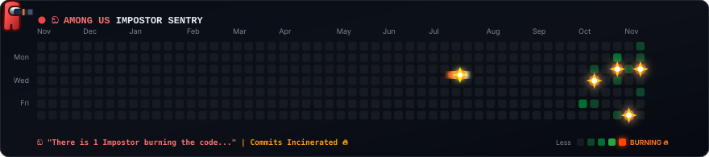

<div align="center">
  <!-- Dynamic Cybersecurity Waving Header -->
  

  <!-- Dynamic Typing SVG -->
  

  <br />

  <!-- Action Badges -->
  <a href="https://www.thenudasahas.site/"></a>
  <a href="mailto:sahas.thenu@gmail.com"></a>
  <a href="https://github.com/thenudasahas2008"></a>
  <a href="https://discordapp.com/users/zyrox_01xi"></a>

  <br /><br />

  <!-- Status & Views -->
  
  
</div>

<br />
<p align="center">
  
</p>

## 👋 About Me

Hi! I'm **Thenuda Sahas** 👨‍💻, a passionate **Computing Student (Pearson BTEC HND)** from Sri Lanka. I specialize in cybersecurity fundamentals, defensive network security, ethical hacking in lab environments, and software tool development.

```bash
$ whoami
> Name         : Thenuda Sahas
> Current Role : Computing Student (Pearson BTEC HND)
> Location     : Sri Lanka 🇱🇰
> Primary Focus: Cybersecurity • Network Defense • Ethical Hacking • Python Scripting
> Philosophy   : "Stay curious. Learn responsibly. Build securely."
```

<br />

<div align="center">
  
  
  
  
</div>

<br />
<p align="center">
  
</p>

## 🛡️ Cybersecurity Focus & Specializations

<div align="center">
  
  
  
  
  
</div>

<br />

## 🧰 Tech Stack & Security Arsenal

<div align="center">
  
</div>

<p align="center"><i>Operating Systems • Scripting • Security Testing • Backend & Web • Developer Tooling</i></p>

<br />
<p align="center">
  
</p>

## ඞ Among Us Impostor Contribution Sentry & Fire Blast 🔥

<!-- Among Us Impostor Incinerating Contributions Animation -->
<div align="center">
  
</div>

<br />

<!-- Real-time GitHub Activity Graph -->
<div align="center">
  
</div>

<br />
<p align="center">
  
</p>

## 📊 GitHub Analytics & Metrics

<div align="center">
  
  
</div>

<br />
<p align="center">
  
</p>

## 🚀 Featured Projects

<div align="center">
  <a href="https://github.com/thenudasahas2008/PromptSentry">
    
  </a>
  <a href="https://github.com/thenudasahas2008/Baduwa">
    
  </a>
</div>

<p align="center">
  <a href="https://www.thenudasahas.site/"></a>
  <a href="https://github.com/thenudasahas2008?tab=repositories"></a>
</p>

<br />
<p align="center">
  
</p>

## 🎯 Learning & Certification Roadmap

```yaml
[2026 ROADMAP - MISSION OBJECTIVES]
-----------------------------------------------------------
[x] Pearson BTEC HND Computing (Current Academic Journey)
[x] Linux Systems & Advanced Bash Command Line Automation
[x] Networking Fundamentals (TCP/IP, Subnetting, Routing)
[>] Web Application Penetration Testing & OWASP Top 10 Labs
[>] SOC / Defensive Blue Teaming & Threat Hunting
[ ] CompTIA Security+ / CEH Practical Preparation
-----------------------------------------------------------
Status: In Progress • Constant Evolution
```

<br />
<p align="center">
  
</p>

## 📫 Connect & Collaborate

<p align="center">
  <a href="mailto:sahas.thenu@gmail.com"></a>
  <a href="https://github.com/thenudasahas2008"></a>
  <a href="https://www.thenudasahas.site/"></a>
  <a href="https://discordapp.com/users/zyrox_01xi"></a>
</p>

<br />

<div align="center">
  <h3>🔐 Stay Curious. Learn Responsibly. Build Securely.</h3>
  
</div>
